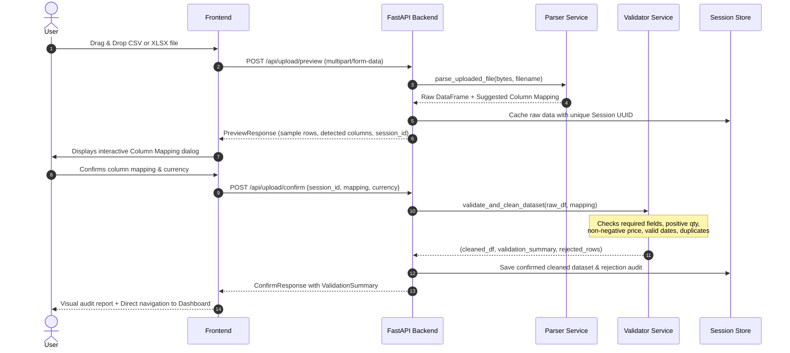

# System Architecture & Technical Design

The **Automated Sales Report Generator** is built as a production-grade, two-tier web application designed for fast, accurate sales data ingestion, anomaly validation, multi-dimensional business analytics, and executive document generation.

---

## 1. High-Level Architecture Diagram

```mermaid
graph TD
    User([Business User / Analyst])
    
    subgraph Frontend ["Frontend Tier (React 19 + TypeScript + Vite)"]
        UI[Tailwind CSS UI System]
        Ctx[SalesContext State & Session Store]
        Charts[Recharts Interactive Visualizations]
        Pages[Dashboard | Upload | Analytics | Products | Reports | Settings]
    end

    subgraph Backend ["Backend Tier (FastAPI + Python 3.11)"]
        API[FastAPI REST API Routes]
        Parser[File Parser: CSV / XLSX Multi-Encoding]
        Validator[Data Quality & Validation Engine]
        Analyzer[Sales Analysis & KPI Computation]
        Store[In-Memory Session Store with 2hr TTL]
        ExcelGen[openpyxl Excel Report Generator]
        PdfGen[ReportLab Vector PDF Generator]
        CsvGen[Sanitized CSV Export Generator]
    end

    User -->|Uploads CSV/XLSX & Interacts| UI
    UI --> Ctx
    Ctx --> Pages
    Pages --> Charts
    Ctx -->|HTTP / JSON Requests| API

    API --> Parser
    Parser --> Validator
    Validator -->|Cleaned DataFrame| Analyzer
    Validator -->|Quarantined Records| Store
    Analyzer --> Store

    API -->|Generate XLSX| ExcelGen
    API -->|Generate PDF| PdfGen
    API -->|Generate CSV| CsvGen
    ExcelGen --> Store
    PdfGen --> Store
    CsvGen --> Store
```

---

## 2. Ingestion & Validation Pipeline



---

## 3. Core Architectural Principles

### 3.1. Session Isolation & Ephemeral Storage
- Every dataset is isolated under a cryptographically random UUID session identifier (`generate_session_id()`).
- Data is maintained in an in-memory thread-safe storage (`SessionStore`) with a sliding 2-hour TTL expiration window.
- Datasets are never intermixed between users.
- Sessions automatically clean up stale memory without requiring database polling.

### 3.2. Data Cleansing & Quarantine Strategy
- **Zero Silent Dropping:** Records are never dropped silently. Every invalid record is recorded in a quarantined audit list with:
  - Original 1-indexed row number
  - Target order identifier
  - Specific failing column
  - Exact human-readable failure reason
- **Downloadable Audit Trail:** Quarantined rows can be exported via `GET /api/reports/validation-errors` for source data reconciliation.

### 3.3. Security & Injection Protection
- **CSV / Excel Formula Injection Prevention:**
  Exported spreadsheets prepend dangerous characters (`=`, `+`, `-`, `@`, `\t`, `\r`) with a single quote (`'`) to neutralize executable formula injection when opened in spreadsheet software like Microsoft Excel or LibreOffice Calc.
- **File Upload Limits:** Strict 15 MB file size boundary checked before parsing.
- **Filename Sanitization:** Basenames sanitized against path traversal and directory spoofing attacks.

### 3.4. Multi-Format Report Generation Engine
- **Excel (.xlsx):** Built using `openpyxl`. Contains 5 distinct styled sheets: Executive Summary, Monthly Performance (with native embedded BarChart), Product Performance, Cleaned Sales Data (with Auto-Filters and Freeze Panes), and Data Quality Audit.
- **PDF (.pdf):** Built using `reportlab`. Generates publication-ready documents with corporate styling, 2x4 KPI metric dashboard, native vector drawing charts, alternating table rows, and explicit accounting disclosures.
- **CSV (.csv):** Cleaned data export in standard UTF-8 format.
